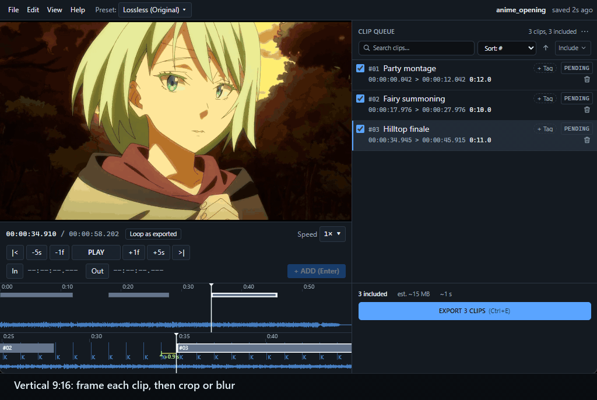

<div align="center">


# RustCut

**Cut one long video into many clips, in one pass.**

A non-destructive batch video clipper: play a long recording, mark In and Out as often as you like,
name each clip, and export every clip as its own file in one action. Export losslessly at disk
speed, or frame-accurately and pre-framed 9:16 or 1:1 for Shorts, TikTok, Reels and feed posts.

[](https://github.com/Sxuoi/rustCut/releases/latest)
[](#install)
[](https://www.rust-lang.org)
[](https://tauri.app)
[](https://svelte.dev)
[](THIRD-PARTY-NOTICES.md)
[](LICENSE)

[Install](#install) · [Features](#features) · [Keyboard shortcuts](#keyboard-shortcuts) · [Build from source](#build-from-source) · [Contact](#contact) · [License](#license)


<sub>RustCut 0.1.1 on Windows 11. The strip under the app shows each key as it is pressed.</sub>

</div>

## Highlights

- **Lossless or frame-accurate.** Lossless export copies the streams, bit-identical and at disk
  speed, starting at the keyframe at or before In. Frame-Accurate re-encodes from the exact frame.
- **Vertical 9:16 or square in one step.** Crop through a 9:16 window you place per clip, keep the
  whole frame over a blurred background, or center a square you place per clip on a blurred
  background, all at 1080x1920; or export square 1080x1080 files. Editable presets flag clips that
  are too long for YouTube Shorts (3:00), TikTok (10:00) or Instagram Reels (3:00).
- **Keyboard first.** Every action has a shortcut, and <kbd>?</kbd> shows them all. See the
  [full list](#keyboard-shortcuts).
- **A batch export you can trust.** Pre-flight checks before anything starts, a hardware encoder when
  one is available, up to four parallel jobs, file-name templates, and a readable reason plus Retry
  for any clip that fails.
- **Nothing gets lost.** The project auto-saves next to the video, clip edits can be undone, and a
  crash or force-quit mid-export leaves no stray FFmpeg processes behind.
- **Timestamps in and out.** Export the clip list as YouTube chapters, CSV, a CMX3600 EDL or FCPXML,
  or paste timestamps to create clips.
- **Opens what you record.** MP4, MKV, MOV, WebM and FLV, including variable-frame-rate, HDR and AV1
  sources.
- **Scriptable.** An [MCP server](#automation-mcp) lets AI agents cut clips with the same engine.

## Features

### Vertical 9:16, framed per clip



Choose **Vertical Crop 9:16** and a 9:16 window appears over the video. Drag it, or press
<kbd>Alt</kbd>+<kbd>←</kbd> / <kbd>Alt</kbd>+<kbd>→</kbd>, to frame each clip, and tick **9:16 only** to
see the result. **Vertical Blur 9:16** keeps the whole frame over a blurred background instead. Both
export 1080x1920 files.

Two square options use the same blurred background. **Square on Blur 9:16** puts a square you place per
clip, just like the 9:16 window, in the middle of a 1080x1920 frame. **Square Blur 1:1** exports a
1080x1080 file with the whole frame on a blurred background. Tick **9:16 only** or **1:1 only** to see
exactly what the export will contain, blurred background included.

### Trim, loop and retime


Drag a clip's edges on the timeline (hold <kbd>Shift</kbd> to snap), press <kbd>P</kbd> to loop it, and
press <kbd>Alt</kbd>+<kbd>I</kbd> or <kbd>Alt</kbd>+<kbd>O</kbd> to move its In or Out to the playhead.
Every edit can be undone.

### Organize the Clip Queue


Tag clips, search by name, tag, #number or time, sort the queue, untick the clips you don't want to
export, and undo anything you deleted.

### Timestamps in and out


Export the clip list as YouTube chapters, CSV, a CMX3600 EDL or FCPXML, or paste timestamps to turn
them into clips.

### Built for the keyboard


Step frame by frame with <kbd>,</kbd> and <kbd>.</kbd>, change speed with <kbd>Shift</kbd>+<kbd>,</kbd>
and <kbd>Shift</kbd>+<kbd>.</kbd>, and press <kbd>?</kbd> for every shortcut.

## Install

On Windows 10 or 11 (x64), run this in PowerShell:

```powershell
irm https://github.com/Sxuoi/rustcut/releases/latest/download/install.ps1 | iex
```

This installs RustCut for the current user, without administrator rights, in
`%LOCALAPPDATA%\RustCut`, with its own FFmpeg and FFprobe and with Start menu and desktop
shortcuts. The script checks the download against its published SHA-256 and checks that the
bundled FFmpeg runs. Run the same line again to update.

To pass options, run the script as a script block:

```powershell
& ([scriptblock]::Create((irm https://github.com/Sxuoi/rustcut/releases/latest/download/install.ps1))) -Uninstall
```

The options are:
- `-Version 0.1.0`: install that release instead of the latest one.
- `-InstallDir <folder>`: install somewhere other than `%LOCALAPPDATA%\RustCut`.
- `-NoShortcuts`: skip the Start menu and desktop shortcuts.
- `-Uninstall`: remove RustCut.

You can also uninstall from Settings > Apps > Installed apps. Either way, settings and caches are
kept in `%APPDATA%\app.rustcut.desktop` and `%LOCALAPPDATA%\app.rustcut.desktop`.

The installer isn't code-signed yet. Running it through the one-liner is fine. If you download
`RustCut-windows-x64-setup.exe` from the release page and open it, SmartScreen warns you first.

The installer includes FFmpeg's `ffmpeg.exe` and `ffprobe.exe`, which are licensed under GPL
version 3. [THIRD-PARTY-NOTICES.md](THIRD-PARTY-NOTICES.md) has their license and where to get the
source.

## Keyboard shortcuts

Press <kbd>?</kbd> in the app to see this list. On macOS, use <kbd>Cmd</kbd> wherever this list says
<kbd>Ctrl</kbd>. Punctuation keys follow their physical position on any keyboard layout.

### Playback

| Keys | Action |
| :--- | :--- |
| <kbd>Space</kbd> or <kbd>K</kbd> | Play / pause |
| <kbd>J</kbd> / <kbd>L</kbd> | Seek back / forward 5 s |
| <kbd>←</kbd> / <kbd>→</kbd> | Seek back / forward 1 s |
| <kbd>,</kbd> / <kbd>.</kbd> | Previous / next frame (pauses) |
| <kbd>Shift</kbd>+<kbd>,</kbd> / <kbd>Shift</kbd>+<kbd>.</kbd> | Slower / faster (0.5× to 3×) |

### Marking

| Keys | Action |
| :--- | :--- |
| <kbd>I</kbd> or <kbd>[</kbd> | Set In at the playhead |
| <kbd>O</kbd> or <kbd>]</kbd> | Set Out at the playhead |
| <kbd>Enter</kbd> or <kbd>A</kbd> | Add the pending range as a clip (Out = playhead if not set) |
| <kbd>Esc</kbd> | Clear marks, leave a text field, or close a dialog |
| <kbd>Shift</kbd>+<kbd>I</kbd> / <kbd>Shift</kbd>+<kbd>O</kbd> | Go to the pending (or selected clip's) In / Out |
| <kbd>Alt</kbd>+<kbd>I</kbd> / <kbd>Alt</kbd>+<kbd>O</kbd> | Set the selected clip's In / Out to the playhead |

### Clip queue

| Keys | Action |
| :--- | :--- |
| <kbd>N</kbd> | Rename the selected (or latest) clip |
| <kbd>↑</kbd> / <kbd>↓</kbd> | Select the previous / next clip and go to its In |
| <kbd>P</kbd> | Loop the selected clip (toggle) |
| <kbd>Delete</kbd> or <kbd>Backspace</kbd> | Delete the selected clips (undoable) |
| <kbd>Ctrl</kbd>+<kbd>Z</kbd> | Undo |
| <kbd>Ctrl</kbd>+<kbd>Shift</kbd>+<kbd>Z</kbd> or <kbd>Ctrl</kbd>+<kbd>Y</kbd> | Redo |

### Project

| Keys | Action |
| :--- | :--- |
| <kbd>Ctrl</kbd>+<kbd>E</kbd> | Open the Export dialog |
| <kbd>Ctrl</kbd>+<kbd>S</kbd> | Save now (auto-save is always on) |
| <kbd>Ctrl</kbd>+<kbd>O</kbd> | Open a video or project |

### Crop window

These work with the Vertical Crop 9:16 and Square on Blur 9:16 presets.

| Keys | Action |
| :--- | :--- |
| <kbd>Alt</kbd>+<kbd>←</kbd> / <kbd>Alt</kbd>+<kbd>→</kbd> | Nudge the crop left / right (0.05) |
| <kbd>Alt</kbd>+<kbd>Shift</kbd>+<kbd>←</kbd> / <kbd>Alt</kbd>+<kbd>Shift</kbd>+<kbd>→</kbd> | Nudge the crop left / right (0.25) |

### Timeline and text fields

| Keys | Action |
| :--- | :--- |
| <kbd>+</kbd> / <kbd>-</kbd> | Zoom the detail timeline in / out (when it has focus) |
| <kbd>Shift</kbd> while dragging a clip edge | Snap to the playhead, a keyframe or another clip's edge |
| <kbd>Esc</kbd> while dragging a clip edge | Cancel the trim |
| <kbd>Enter</kbd> / <kbd>Esc</kbd> in a rename field | Commit / cancel the rename (other shortcuts pause while you type) |
| <kbd>?</kbd> | Show the keyboard shortcuts |

## Build from source

Built from [`docs/PRD.md`](docs/PRD.md) (v1.3). Architecture and contracts:
[`docs/ARCHITECTURE.md`](docs/ARCHITECTURE.md).

Stack: Rust (edition 2024) · Tauri v2 · Svelte 5 + TypeScript + Tailwind v4 · FFmpeg/FFprobe as
sidecars.

### Prerequisites

* Rust stable (≥ 1.89) with the MSVC toolchain on Windows (Visual Studio C++ Build Tools)
* Node.js ≥ 20 and npm
* FFmpeg ≥ 6.1 with libx264 (and `zscale` for HDR tone-mapping), e.g. `winget install Gyan.FFmpeg`
* Windows: WebView2 runtime (preinstalled on Windows 11)

### Setup

```bash
npm install
npm run sidecars      # copies ffmpeg/ffprobe into src-tauri/binaries/
npm run bindings      # regenerates src/lib/bindings from rustcut-model
```

### Run

```bash
npm run tauri dev     # desktop app with hot reload
npm run dev           # UI only, in a browser, against the in-memory mock backend
npm run tauri build   # installers in target/release/bundle/
```

### Test

```bash
cargo test            # engine crates (FFmpeg-based tests generate fixtures into .fixtures/)
npm test              # UI unit tests (vitest)
npm run check         # svelte-check / TypeScript
```

### Release (Windows)

```bash
npm run release:windows
```

This builds the per-user NSIS installer (`npx tauri build --bundles nsis`, sidecars included) and
puts the three release files in `target/release-assets/`:
- `RustCut-windows-x64-setup.exe`
- `RustCut-windows-x64-setup.exe.sha256`
- `install.ps1`

Upload them to a release tagged `v<version>`. The one-line installer always fetches the latest
release's files by these names.

## Automation (MCP)

`crates/rustcut-mcp` is an MCP server that lets AI agents clip videos with RustCut's engine, headlessly. It
reads and writes the same project files as the desktop app, so clips an agent adds show up when you open the
video in RustCut. See [crates/rustcut-mcp/README.md](crates/rustcut-mcp/README.md).

## Contact

Made by Sxuoi. Questions, ideas or clips you made with RustCut are welcome.

[](https://www.instagram.com/pamungkasjibagas/)


- Instagram: [@pamungkasjibagas](https://www.instagram.com/pamungkasjibagas/)
- Discord: **@sxuoi**
- Bugs and feature requests: [GitHub issues](https://github.com/Sxuoi/rustCut/issues)

## License

RustCut's source code is released under the [MIT License](LICENSE). Two things are not covered by it:

- FFmpeg and FFprobe are separate programs that ship with the Windows installer under GPL version 3;
  see [THIRD-PARTY-NOTICES.md](THIRD-PARTY-NOTICES.md).
- The footage in the preview GIFs is the creditless opening of *That Time I Got Reincarnated as a
  Slime* season 2, © its rights holders.
