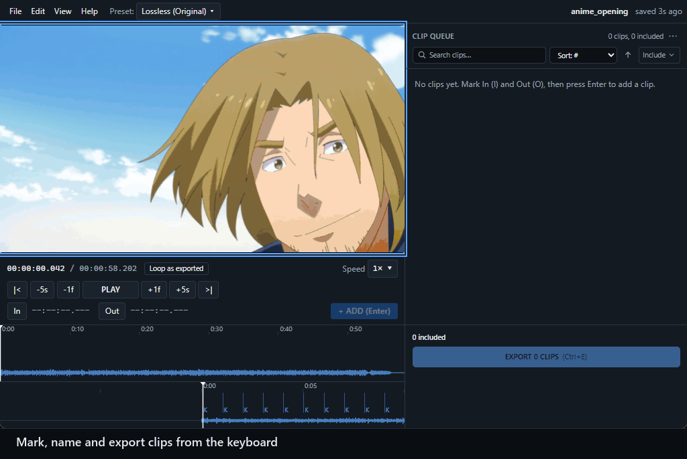
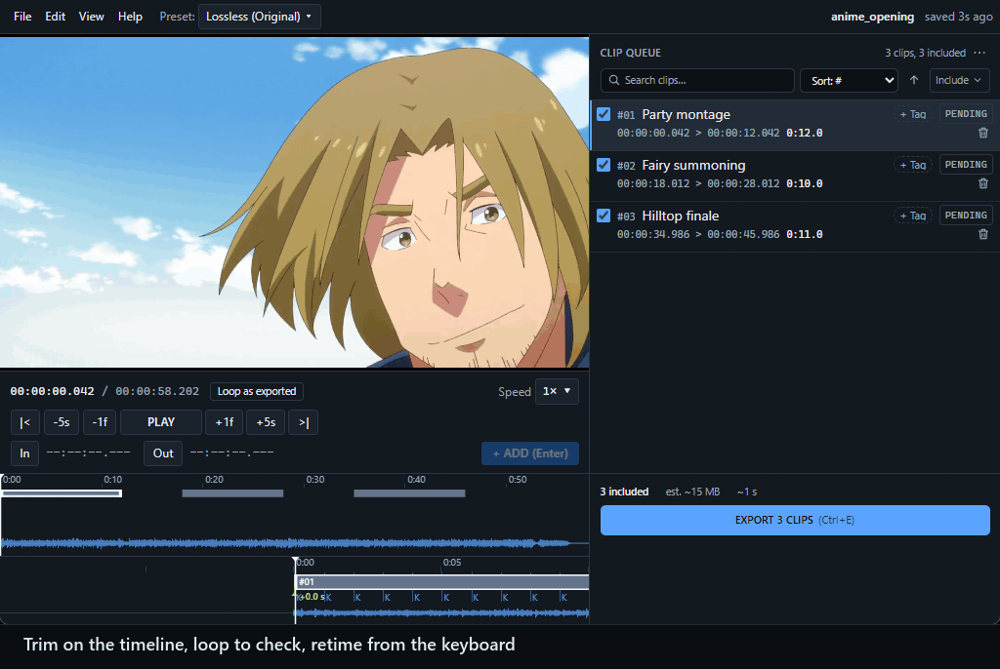
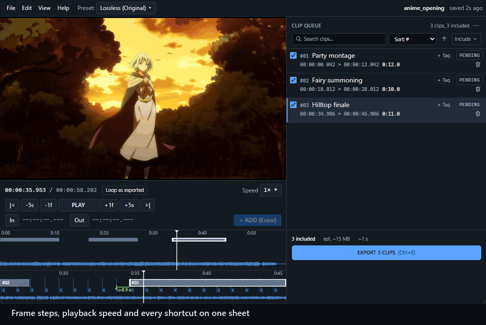

# RustCut

Non-destructive batch video clipper: play a long recording, mark In/Out as often
as you like, name each clip in the Clip Queue, and export every clip as its own
file in one action — losslessly at disk speed, or frame-accurately and
pre-framed for vertical platforms (9:16 crop or blur).

Built from `docs/PRD.md` (v1.3). Architecture and contracts: `docs/ARCHITECTURE.md`.

Stack: Rust (edition 2024) · Tauri v2 · Svelte 5 + TypeScript + Tailwind v4 ·
FFmpeg/FFprobe as sidecars.

## App preview



Keys in the preview: <kbd>Space</kbd> play or pause, <kbd>I</kbd> and <kbd>O</kbd> mark In and Out,
<kbd>L</kbd> jump 5 s ahead, <kbd>Enter</kbd> add the clip, <kbd>N</kbd> name it, and
<kbd>Ctrl</kbd>+<kbd>E</kbd> then <kbd>Enter</kbd> export every clip. The footage in these previews is
the creditless opening of *That Time I Got Reincarnated as a Slime* season 2, © its rights holders.

### Vertical 9:16, framed per clip


Choose **Vertical Crop 9:16** and a 9:16 window appears over the video. Drag it, or press
<kbd>Alt</kbd>+<kbd>←</kbd> / <kbd>Alt</kbd>+<kbd>→</kbd>, to frame each clip, and tick **9:16 only** to
see the result. **Vertical Blur 9:16** keeps the whole frame over a blurred background instead. Both
export 1080x1920 files.

### Trim, loop and retime



Drag a clip's edges on the timeline (hold <kbd>Shift</kbd> to snap), press <kbd>P</kbd> to loop it, and
press <kbd>Alt</kbd>+<kbd>I</kbd> or <kbd>Alt</kbd>+<kbd>O</kbd> to move its In or Out to the playhead.
Every edit can be undone.

### Organize the Clip Queue


Tag clips, search by name, tag, #number or time, sort the queue, untick the clips you don't want to
export, and undo anything you deleted.

### Timestamps in and out


Export the clip list as YouTube chapters, CSV, a CMX3600 EDL or FCPXML, or paste timestamps to turn
them into clips.

### Built for the keyboard



Step frame by frame with <kbd>,</kbd> and <kbd>.</kbd>, change speed with <kbd>Shift</kbd>+<kbd>,</kbd>
and <kbd>Shift</kbd>+<kbd>.</kbd>, and press <kbd>?</kbd> for every shortcut.

## Install (Windows 10/11 x64)

In PowerShell:

```powershell
irm https://github.com/Sxuoi/rustcut/releases/latest/download/install.ps1 | iex
```

This installs RustCut for the current user, without administrator rights, in
`%LOCALAPPDATA%\RustCut`, with its own FFmpeg and FFprobe and with Start menu and desktop
shortcuts. The script checks the download against its published SHA-256 and checks that the
bundled FFmpeg runs. Run the same line again to update.

To pass options, run the script as a script block:

```powershell
& ([scriptblock]::Create((irm https://github.com/Sxuoi/rustcut/releases/latest/download/install.ps1))) -Uninstall
```

The options are:
- `-Version 0.1.0`: install that release instead of the latest one.
- `-InstallDir <folder>`: install somewhere other than `%LOCALAPPDATA%\RustCut`.
- `-NoShortcuts`: skip the Start menu and desktop shortcuts.
- `-Uninstall`: remove RustCut.

You can also uninstall from Settings > Apps > Installed apps. Either way, settings and caches are
kept in `%APPDATA%\app.rustcut.desktop` and `%LOCALAPPDATA%\app.rustcut.desktop`.

The installer isn't code-signed yet. Running it through the one-liner is fine. If you download
`RustCut-windows-x64-setup.exe` from the release page and open it, SmartScreen warns you first.

The installer includes FFmpeg's `ffmpeg.exe` and `ffprobe.exe`, which are licensed under GPL
version 3. [THIRD-PARTY-NOTICES.md](THIRD-PARTY-NOTICES.md) has their license and where to get the
source.

## Prerequisites

* Rust stable (≥ 1.89) with the MSVC toolchain on Windows (Visual Studio C++ Build Tools)
* Node.js ≥ 20 and npm
* FFmpeg ≥ 6.1 with libx264 (and `zscale` for HDR tone-mapping), e.g. `winget install Gyan.FFmpeg`
* Windows: WebView2 runtime (preinstalled on Windows 11)

## Setup

```bash
npm install
npm run sidecars      # copies ffmpeg/ffprobe into src-tauri/binaries/
npm run bindings      # regenerates src/lib/bindings from rustcut-model
```

## Run

```bash
npm run tauri dev     # desktop app with hot reload
npm run dev           # UI only, in a browser, against the in-memory mock backend
npm run tauri build   # installers in target/release/bundle/
```

## Test

```bash
cargo test            # engine crates (FFmpeg-based tests generate fixtures into .fixtures/)
npm test              # UI unit tests (vitest)
npm run check         # svelte-check / TypeScript
```

## Release (Windows)

```bash
npm run release:windows
```

This builds the per-user NSIS installer (`npx tauri build --bundles nsis`, sidecars included) and
puts the three release files in `target/release-assets/`:
- `RustCut-windows-x64-setup.exe`
- `RustCut-windows-x64-setup.exe.sha256`
- `install.ps1`

Upload them to a release tagged `v<version>`. The one-line installer always fetches the latest
release's files by these names.

## Automation (MCP)

`crates/rustcut-mcp` is an MCP server that lets AI agents clip videos with RustCut's engine, headlessly. It
reads and writes the same project files as the desktop app, so clips an agent adds show up when you open the
video in RustCut. See [crates/rustcut-mcp/README.md](crates/rustcut-mcp/README.md).
